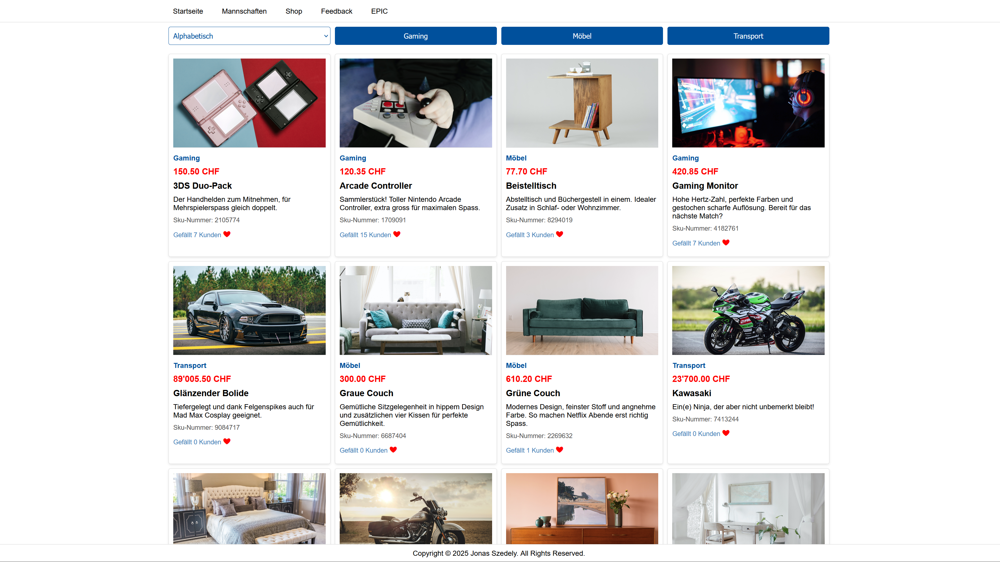
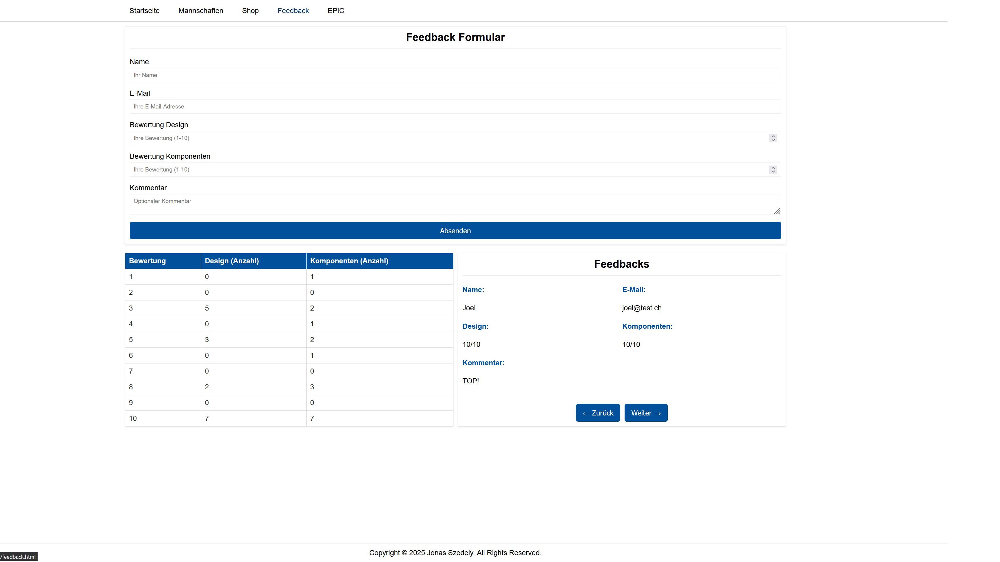
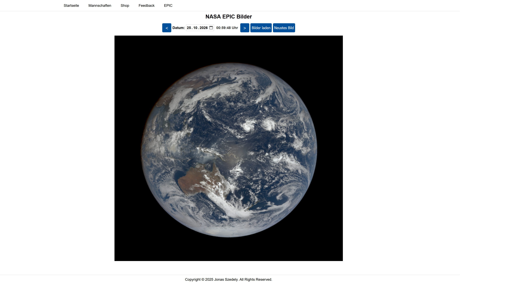

# Website – FFHS Project

A practice project from my studies at FFHS (Q4 2024), built with plain **HTML**, **CSS** and **JavaScript**, without any frameworks.

The goal was to try out different techniques: responsive layouts, DOM manipulation, form handling, data storage and working with external APIs.

## Features

- **Shop:** products, category filters, sorting and likes are all handled through an external REST API
- **Feedback form:** submissions are validated and sent to the API; all feedback is loaded back and shown as a rating overview table and in a viewer to browse through each entry
- **NASA EPIC:** daily images of the whole Earth from NASA's [EPIC API](https://epic.gsfc.nasa.gov/) (Earth Polychromatic Imaging Camera on the DSCOVR satellite), with date picker, previous/next navigation and a shortcut to the latest image
- **Responsive design** for desktop and mobile

## Screenshots

**Shop**


**Feedback**


**NASA EPIC**


## Getting Started

1. Clone the repository:
   ```bash
   git clone https://github.com/JonasSzedely/Website-FFHS-Projekt.git
   ```
2. Open `index.html` in your browser.

## Author

Jonas Szedely
